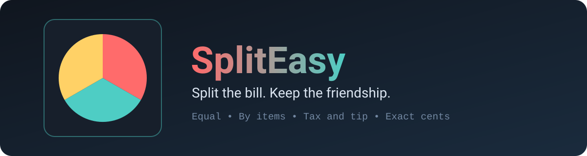

<p align='center'></p>

# SplitEasy 🍕

**Split the bill without the awkward math.** Equal or by items, tax and tip included, and the cents always add up. 💸

No accounts, no build step, no dependencies. Everything runs in your browser and nothing is stored.

## ✨ What you get

- ⚖️ **Two modes**: split the whole bill equally, or enter what each person ordered plus a shared amount
- 🧾 **Tax and tip** as percentages (tip is on the pre-tax amount)
- 🧮 **Exact cents**: shares are rounded fairly and always add up to the total
- 👥 **1 to 12 people** with editable names
- 📋 **Copy summary** for your group chat
- 🌓 Light and dark theme follow your system

## ✅ Tested

```bash
node split.test.js
```

Checks 100.00 / 3 with tax and tip (43.34, 43.33, 43.33), an itemized example, and **2,000 random bills** whose shares must add up to the total exactly.

## 🚀 Run it

```bash
git clone https://github.com/CyberLoop-dev/spliteasy.git
cd spliteasy
python3 -m http.server 8000   # or just open index.html
```

## 📁 Structure

```text
index.html  styles.css  app.js   # interface
split.js                         # maths, no DOM
split.test.js                    # tests
assets/                          # logo and banner
```

## ⚠️ Limitations

- Tax and tip are shared in proportion to each person's subtotal.
- No uneven splitting of a single shared item, and no currency conversion.

## 📄 License

[MIT](LICENSE)
